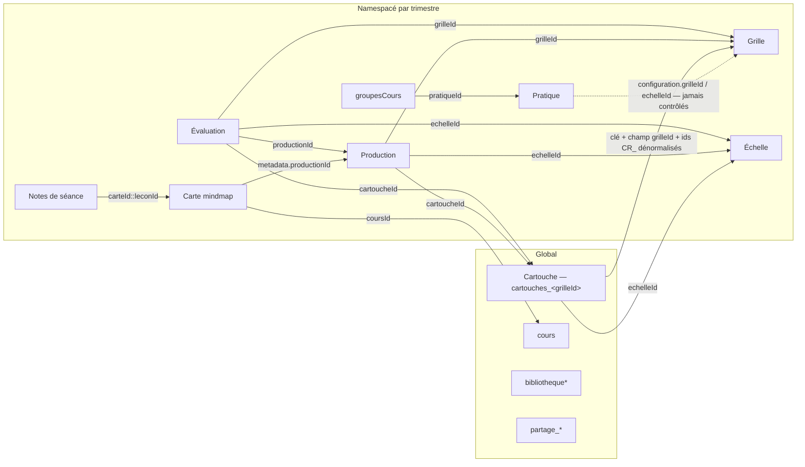

# Audit — modèle d'objets de l'onglet Conception (Labo Codex)

Date : 2026-08-30. Dépôt : `~/Documents/GitHub/Monitorage_v6`, branche `main` au commit `810c3ee8` (1.106.10). L'arbre de travail porte les modifications non commitées d'une session parallèle (chantier S2 du plan chaîne-importation : `index.html`, `js/travaux-ui.js`, bumps de version) — elles ne touchent pas le périmètre Conception ; l'audit porte sur la version de travail. Aucun fichier du dépôt n'a été modifié, hormis la régénération prévue de `scripts/audit-ssot.{json,md}`.

Périmètre : les six sous-sections de l'onglet Conception (`#conception-carte`, `#conception-productions`, `#conception-grille-criteres`, `#conception-echelle-performance`, `#conception-retroactions`, `#conception-pratiques-notation`) et leurs ~42 000 lignes de JS. Élargissements annoncés, en lecture seule : `js/trimestres.js` (mécanique `cle()`, archivage, migration #358), `js/donnees-v2.js` (suppressions de l'écran Réglages › Données), `js/import-export.js` (imports codex/sélectif), `js/partage-*.js` (pipeline .lcz), les lecteurs d'évaluation (`evaluation-chargement.js`, `evaluation-retroaction.js`, `liste-evaluations.js`) pour les références entrantes.

Nature de l'audit : cohérence du modèle d'objets — le code dit-il la même chose partout, une seule fois, et les objets tiennent-ils ensemble. Ce n'est pas un audit de robustesse. Cet audit est le **temps 1 d'une séquence en trois temps** : la carte (ici), puis trois audits ciblés (Z1–Z3, section 3), puis les correctifs. Conformément au cadrage, ce rapport ne propose **aucun diff** : les diffs seront produits par les audits Z1–Z3, dans le format du rapport `AUDIT-chaine-importation-travaux-2026-08-30.md` (section 3 : diffs non appliqués, chacun nommant ce qu'il retire).

Convention de certitude : **VÉRIFIÉ** = lu dans le code, extrait cité ; **INFÉRÉ** = conséquence déduite du code sans exécution ; **SUPPOSÉ** = demande un test réel. Chaque constat porte aussi sa nature : **CONFLIT** (deux vérités concurrentes pour la même donnée — corruption ou perte possible), **INCOHÉRENCE** (le code ne dit pas la même chose partout, sans conséquence prouvée), **RÉSIDU** (mort, orphelin ou sans objet — politique zéro-dette : à RETIRER, pas à contourner).

---

## 1. Synthèse

Le soupçon du cadrage — des corrections de sessions successives qui se recouvrent, s'annulent ou laissent des orphelins — est confirmé, mais il est localisé. La carte (section 2.1) montre un modèle globalement sain : générateur d'identifiants unique, quatre modules propriétaires disciplinés (`db.modifier`), un pipeline de partage exemplaire, une carte de planification à écrivain unique. La dérive se concentre en quatre foyers :

1. **La frontière de portée des cartouches.** Les grilles sont namespacées par trimestre depuis #358 ; leurs cartouches restent une clé **globale** `cartouches_<grilleId>` — et le même id de grille dans plusieurs trimestres est le cas *nominal* (la migration #358 a copié chaque grille id conservé, et les gabarits en dur sont semés partout). Les cartouches de ces exemplaires homonymes partagent donc une seule collection : éditer dans un trimestre modifie ce que voit l'autre. S'y ajoute un cerveau divisé sur trimestre archivé : l'éditeur écrit la clé globale, l'écran d'évaluation lit la copie archivée.
2. **L'archivage de trimestre écrase du vivant.** `creerSnapshotRessources` date d'avant #358 : il réécrit `<trim>_grillesTemplates`/`<trim>_echellesTemplates` — devenues les collections de travail — avec le seul sous-ensemble « utilisé », et lit les pratiques du trimestre **actif** pour les écrire sous le namespace du trimestre archivé. C'est la classe exacte de l'incident #340, dans le code actuel.
3. **Les suppressions n'ont pas de politique.** Grilles : quatre chemins, gardes inégales, deux homonymes à politiques opposées. Échelles : trois chemins, un seul gardé (borné au trimestre actif). Pratiques : trois chemins, dont un sans aucun garde qui peut orpheliner la pratique active. Et aucun chemin, sur aucun objet, ne traite les références entrantes (`grilleId`/`echelleId`/`cartoucheId`/`productionId` des productions et des évaluations) : ni contrôle avant, ni réparation après. L'incident #542 (339 évaluations pointant une échelle disparue) appartient à cette classe.
4. **Le legacy des quatre sections matérielles est encore câblé.** L'ancien système d'échelles complet (HTML + moteur au boot + clés nues `configEchelle`/`niveauxEchelle`) coexiste avec l'éditeur moderne derrière 8 ids DOM en double ; des stubs « compatibilité » cachés sont encore lus dans les quatre sections ; deux paires de fonctions `window` en double laissent l'ordre de chargement décider du comportement.

Ce qui tient : structure HTML des six sous-sections équilibrée (la cicatrice #155 est guérie) ; `modalitesEvaluation` est devenu le pattern propriétaire exemplaire annoncé ; `planification_mindmap` et `bibliothequeAlignements` sont à écrivain unique ; le pipeline partage #329 n'écrit jamais dans les collections utilisateur et régénère les ids ; `cle()` échoue désormais bruyamment (#464/CT-26).

---

## 2. Constats

### 2.1 La carte du modèle d'objets (repères)

> Cette section est autoportante : elle peut être collée dans la documentation du projet comme référence commune.

#### Objets, clés, régimes, propriétaires

| Objet | Clé de travail | Régime | Propriétaire réel (mesuré) | Écrivains effectifs | Référencé par (et par quoi) |
|---|---|---|---|---|---|
| Production | `cle('productions')` | NS (trimestres.js:63) + garde d'écriture #340 (productions-namespace-garde.js:180) | famille `productions*.js` | + import-export.js:2497/2862, migrations.js:93/1036, pratiques-gestion.js:2723, partage-section.js | évaluations (`productionId`), carte mentale (`metadata.productionId`, `activites[].productionId`) |
| Grille de critères | `cle('grillesTemplates')` | NS depuis #358 (trimestres.js:111 ; figure AUSSI dans `CLES_TEMPLATES_ARCHIVES` l.163 — voir M1) | grilles.js (~25 sites `db.modifier`) | + wizard-pratique-v2.js:1893, import-export.js:2453/2772, spe-specifications.js:902, cartouches.js:4875, donnees-v2.js:1591, trimestres.js:752, partage-section.js:182 | productions (`grilleId`), cartouches (clé de stockage + champ `grilleId` + ids de critères dénormalisés), évaluations (`grilleId`), pratiques (`configuration.grilleId`, non contrôlé) |
| Cartouche | `cartouches_<grilleId>` | **GLOBALE nue** (trimestres.js:344) ; copie `<trim>_cartouches_*` seulement si trimestre archivé ET copie existante (l.333-340) | cartouches.js — écrit la clé NUE directement, sans `cle()` (~14 sites : 69, 76, 333, 545, 807, 1022, 1576, 1631, 1808…) | + import-export.js:2526, donnees-v2.js:1571 (remove), trimestres.js:761 (archivage), partage-section.js:193 | productions (`cartoucheId`), évaluations (`cartoucheId`) |
| Échelle de performance | `cle('echellesTemplates')` | NS depuis #358 (trimestres.js:112) | echelles.js (~27 sites) | + import-export.js:2427/2800, donnees-v2.js:1640, trimestres.js:753, partage-section.js:270 | productions (`echelleId`), cartouches (`echelleId`), évaluations (`echelleId`), pratiques (`configuration.echelleId`, non contrôlé) |
| Banque de rétroaction | — | — | **Il n'existe pas d'objet « banque de rétroaction » stocké.** `#conception-retroactions` est l'écran des cartouches (navigation.js:239-243 ; sidebar cartouches.js:121/3449). Les clés `retroactions*` appartiennent aux outils d'annotation de Travaux (travaux-outils.js), hors Conception | — | — |
| Pratique de notation | `cle('pratiquesConfigurables')` | NS depuis le 24 mai 2026 (trimestres.js:102 ; aussi dans `CLES_TEMPLATES_ARCHIVES` l.165 — M1) | **aucun propriétaire unique — 7 écrivains** : pratiques.js:113/491/2426, pratiques-gestion.js:654, wizard-pratique-v2.js:2883, pratique-manager.js:148-239, donnees-v2.js:1553, import-export.js:2733, partage-section.js:276 | l'activation, elle, a une porte unique : `groupesCours[id].pratiqueId` via `changerPratiqueActive` (pratique-manager.js:77-96) — sain | groupesCours (`pratiqueId`), comparateur, tableau de bord |
| Modalités d'évaluation | `cle('modalitesEvaluation')` | NS | `js/pratiques/modalites-evaluation.js`, **seul écrivain littéral** (l.49), API `lire()`/`modifier()`/`remplacer()` synchrone | tous les autres passent par l'API (vérifié : aucune réassignation externe) | ~18 modules lecteurs |
| Carte de planification | `planification_mindmap` | NS (trimestres.js:82) | planification-donnees.js (via `CLE_DONNEES` l.13) — planification-carte.js (11 838 l.) ne touche jamais la clé | + main.js:636 (migration #367), demo-namespace.js:246 (clé démo) | nœuds → productions (`metadata.productionId`), index → cours global (`coursId`, orphelin réparable) |
| Notes de séance | `planification_seances` | NS, clés composites `carteId::leconId` | planification-donnees.js:576 | + **planification-carte.js:446/3233 via `CLE_SEANCES` (invisibles au scanner SSOT — M11)**, main.js:521 (migration) | export du plan de cours |
| Alignement | — | — | **Pas un objet distinct : c'est une carte, vue de la bibliothèque.** `bibliothequeAlignements` (G, planification-bibliotheque.js:14) stocke des exports de cartes (`ALI_*`) ; l'import re-clone avec id neuf. Dans planification-export.js, « alignement » est un niveau de profondeur d'export (l.29-40), pas un objet | planification-bibliotheque.js, écrivain unique | — |
| Bibliothèques (pool) | `bibliothequeGrilles/Echelles/Cartouches/Productions/Pratiques` | G, clés littérales sans `cle()` | modules `*-bibliotheque.js` (+ donnees-v2.js:1666 init, spe-specifications.js:269) | l'ajout au pool conserve l'id de l'objet de travail (voulu, #291) | — |
| Partage (.lcz) | `partage_grilles/echelles/cartouches/productions/pratiques` + `partage_packagesImportes` | G, ids préfixés `PARTAGE_<suffixe>_` | partage-import.js (l'import n'écrit **jamais** dans les collections utilisateur ; partage-section.js lit sans écrire) | — | « Dupliquer » copie vers les collections de travail avec id régénéré |

**Identifiants** : un seul générateur, `window.genererIdUnique(prefix)` (main.js:33-43) — horodatage + compteur 16 bits + 48 bits aléatoires ; collision fortuite non plausible. Préfixes : `PROD_`, `GRILLE_`, `CR_`, `CHP_`, `CART_`, `ECH_`, `ALI_`, `pratique_`/`PRAT_`/`config_` (hétérogène selon la porte, cosmétique). Ids réservés en dur : `GRILLE_GENERIQUE`, `ECHELLE_GENERIQUE`, `CART_GENERIQUE`, `GABARIT_*` (main.js:139-149), re-semés par trimestre sauf tombstone dans `ressourcesSupprimees`.

**Les mêmes ids existent légitimement en plusieurs exemplaires** : (a) dans deux trimestres — la migration #358 a copié chaque grille/échelle id conservé dans le namespace de chaque trimestre qui l'utilisait (`_peuplerCopieModeleNamespace`, trimestres.js:812-828), et `_toutesModelesTravail` (l.925+) assume des « collisions d'id à contenu divergent », premier gagnant (D-D6) ; (b) entre sélection et pool de bibliothèque (#291). Seules la duplication et les imports régénèrent l'id.

#### Références croisées

Toute flèche qui traverse la frontière NS → G (les quatre flèches vers Cartouche, la flèche vers cours) est une traversée de régime de portée. Celle vers `cours` est traduite et réparable (planification-donnees.js:100-125) ; celles vers les cartouches ne le sont pas (constat B2).

#### États d'édition transitoires (hors stockage)

| État | Portée réelle | Tenue |
|---|---|---|
| `window.tempCriteres` | grilles.js seul (41 sites — pas multi-modules) | **fuit** : survit à l'abandon et à la bascule de trimestre (constat S3) |
| `window._niveauxNouvelleEchelle` / `_reperesNouvelleEchelle` | echelles.js seul | propre à l'annulation et au save ; **fuit à la bascule** (S3) |
| `window.cartoucheActuel` | cartouches.js + export-pdf.js:1321 | double source (variable module + window, cartouches.js:3309-3310) ; purge de bascule complète — à surveiller |
| clés nues `configEchelle` / `niveauxEchelle` | globales, persistantes | état legacy partagé entre trimestres et sessions (constat S9) |
| `wizardState` (wizard-pratique-v2.js:27) | portée module, pas sur window | sain |

Les quatre autres globaux du cadrage — `planificationDonnees`, `modalitesEvaluation`, `repertoiresBibliotheque`, `planificationCarte` — sont des API de fonctions **sans état mémoire** (chaque appel résout `cle()` au moment de l'appel) : sains. `IDS_GABARITS_HARDCODES` est une constante à écrivain unique, jamais mutée. Aucun des six n'a de double définition `window.X =` : l'ordre de chargement ne fait gagner personne — les seules doubles définitions du périmètre sont celles du constat S5.

### 2.2 BLOQUANT

#### B1 — L'archivage de trimestre écrase les collections vivantes et snapshote les pratiques du mauvais trimestre [CONFLIT]

`trimestres.js:728-799` (`creerSnapshotRessources`, appelé par `archiverTrimestre` l.601-644). **VÉRIFIÉ** (code), **SUPPOSÉ** (perte effective — à trancher par test).

- Lignes 741-742 : lecture de `<id>_grillesTemplates` / `<id>_echellesTemplates` ; filtrage aux modèles « utilisés » (référencés par une production ou une évaluation) ; lignes 752-753 : **réécriture des mêmes clés** avec le sous-ensemble filtré. Avant #358 ces clés étaient des copies d'archive neuves ; depuis #358 ce sont les **collections de travail vivantes** du trimestre. Archiver retire donc du stockage toute grille ou échelle du trimestre non « utilisée ».

  > ⚠⚠ **CORRECTION DU 30 AOÛT 2026 AU SOIR — la phrase d'origine disait « elle ne survit que dans le
  > snapshot de backup, l.782 ». C'EST FAUX**, mesuré par `kuekatsheu-c5` (audit Z1) et vérifié par
  > `kuekatsheu-bc`. `trimestres.js:766-779` construit `ressources` avec `grilles: grillesUtilisees`,
  > `echelles: echellesUtilisees` et `pratiques: pratiquesUtilisees` — **le sous-ensemble déjà filtré,
  > c'est-à-dire les survivants** — et `cartouches: nbCartouchesCopies`, qui est **un nombre**, pas les
  > cartouches. Le commentaire du code annonce pourtant « backup complet ». **Les modèles retirés ne
  > survivent NULLE PART.** Cette phrase avait servi à formuler l'option B de la décision D1 (« archiver
  > quand même en acceptant le risque, un snapshot existe ») : ce filet n'existe pas. Grégoire a tranché
  > l'option A, donc aucun dommage — la correction est ici pour que la phrase ne se relise pas comme un
  > fait vérifié. Conséquence : le **moratoire D1 a été élargi le même soir à trois gestes** (archiver,
  > supprimer, exporter une ligne non active) — voir T0.1 du plan et l'en-tête de `RELAIS.md`.
- Ligne 743 : les pratiques snapshotées sont lues via `cle('pratiquesConfigurables')` — le trimestre **ACTIF** — alors qu'on ne peut archiver qu'un trimestre non actif (l.615-618). Le snapshot écrit dans `<id>_pratiquesConfigurables` (l.754) un filtrage de la collection **d'un autre trimestre** : lecture sous un namespace, écriture sous un autre — la classe de l'incident #340, dans le code actuel, sans garde (la garde #340 ne couvre que `productions`).
- `identifierTemplatesUtilises` (l.653-716) lit en outre la clé globale nue `grillesTemplates` (l.676) — vidée au boot par `viderModelesGlobalHerite` (l.884-913) — pour en tirer `g.echelleId`, champ retiré des grilles (#574/#578). Contribution nulle en régime post-#358 : bloc mort dans une fonction dangereuse. VÉRIFIÉ (lecture) / INFÉRÉ (nullité).

Scénario : Grégoire archive A2025 en fin de session ; toute grille d'A2025 qui n'a servi à aucune évaluation disparaît de `a2025_grillesTemplates` ; et `a2025_pratiquesConfigurables` reçoit un extrait des pratiques de H2026.

#### B2 — Les cartouches vivent hors du régime de portée de leur grille [CONFLIT]

Hypothèse du cadrage : **CONFIRMÉE, et plus large que formulée.** Trois mécanismes, tous VÉRIFIÉS ; la manifestation à l'écran est SUPPOSÉE (dépend de la divergence effective des contenus dans les données réelles — question pour Z1).

- **Régime** : `cle()` rend `cartouches_*` nue pour tout trimestre non archivé (trimestres.js:344 — `nomCle.startsWith('cartouches_') → return nomCle`). Le module propriétaire n'appelle d'ailleurs jamais `cle()` : tout le CRUD de cartouches.js accède à `cartouches_${grilleId}` en clé littérale.
- **Partage entre trimestres** : le même `grilleId` dans deux trimestres étant le cas nominal (migration #358 id conservé ; gabarits semés par trimestre, grilles.js:1482-1509 ; `cartouches_GRILLE_GENERIQUE` écrite en global, cartouches.js:213), les cartouches des exemplaires homonymes **partagent une seule clé**. Cohérent en apparence tant que la grille reste identique des deux côtés ; dès qu'elle est modifiée dans un seul trimestre, les commentaires `<critereId>_<code>` de la cartouche se désalignent dans l'autre.
- **Cerveau divisé sur trimestre archivé** : les lecteurs d'évaluation passent par `cle('cartouches_X')` et sont routés vers la copie archivée `<trim>_cartouches_X` quand elle existe (evaluation.js:1491, evaluation-chargement.js:717/810/1163, evaluation-retroaction.js:250, liste-evaluations.js:913, synthese-retroaction-data.js:1229) ; le propriétaire cartouches.js lit et écrit toujours la clé globale. Sur un trimestre archivé, l'éditeur de cartouches et l'écran d'évaluation regardent **deux stockages différents**.
- **Effet de bord** : les gardes d'orphelinage à la suppression d'une grille (grilles.js:2676-2680, 3841-3869) lisent la clé globale — des cartouches créées dans un *autre* trimestre bloquent la suppression dans le trimestre actif, avec un message qui n'explique pas d'où elles viennent. VÉRIFIÉ (blocage) / INFÉRÉ (confusion).

### 2.3 SÉRIEUX

#### S1 — Suppression d'une pratique : trois chemins, trois politiques, orphelins possibles [CONFLIT]

**VÉRIFIÉ.** (1) pratiques.js:1115-1151 bloque si la pratique est active ou utilisée — mais son garde `getCoursUtilisantPratique` (pratiques.js:282-298) n'inspecte que `cours` global et la pratique du groupe **actif**, pas les `pratiqueId` des autres groupes-cours ni des autres trimestres. (2) comparateur-pratiques.js:609-627 → `PratiqueManager.supprimerPratique` : seul le garde « pratique active » (pratique-manager.js:230-236). (3) donnees-v2.js:1543-1557 (`supprimerPratiqueDefinitivement`) : **aucun garde** — la modale amont (l.1350-1354) affiche les dépendances (via son propre `verifierDependancesPratique` l.1048-1074, qui scanne correctement tous les trimestres) mais n'en bloque aucune ; on peut supprimer la pratique **active** → `groupesCours[].pratiqueId` orphelin.

S'y ajoutent deux fonctions **homonymes** `verifierDependancesPratique` aux sémantiques opposées : pratiques-gestion.js:602-618 = dépendances *sortantes* manquantes (et ne lit que `pratique.configuration`, aveugle au format `.config`) ; donnees-v2.js:1048 = usages *entrants*. IIFE distinctes, pas d'écrasement, mais confusion garantie entre sessions. [INCOHÉRENCE]

#### S2 — Suppressions de grilles et d'échelles : gardes inégales, homonymes divergents, références entrantes jamais traitées [CONFLIT]

**VÉRIFIÉ.** Grilles, quatre chemins : `supprimerGrille` (grilles.js:929-956) **sans garde cartouches**, atteignable (`#vueGrillesCriteres`, index.html:4985, appels vivants grilles.js:739/950/1037/1412/1533/4351) — c'est le chemin du cas réel du 24 août (cartouches invisibles) ; `supprimerGrilleDepuisSidebar` (l.3841-3897) et `supprimerGrilleDefinitivement` (l.2667-2712) gardés ; **homonyme** `supprimerGrilleDefinitivement` dans donnees-v2.js:1564-1601, politique opposée — `db.remove('cartouches_<id>')` sans garde, la confirmation par saisie du nom tenant lieu de protection.

Échelles, trois chemins : `supprimerEchelle` (echelles.js:953-977) sans contrôle d'usage, atteignable (index.html:5127) ; `supprimerEchelleDepuisSidebar` avec `verifierUtilisationEchelle` (l.4269-4286) — borné aux évaluations du trimestre **actif**, ignore `production.echelleId` et `cartouche.echelleId` ; donnees-v2.js:1624 sans contrôle.

Sur **aucun** chemin, pour **aucun** objet, les références entrantes (`productions.grilleId/echelleId/cartoucheId`, `évaluations.*`, `production.productionId` côté carte) ne sont contrôlées avant ni réparées après. Suppression de cartouche (cartouches.js:1807-1849) et de production (productions-liste.js:403-438) : même absence. L'incident #542 (339 évaluations → échelle disparue) est une occurrence de cette classe.

#### S3 — Les états de création survivent à l'abandon et à la bascule de trimestre ; le reset #466/CO-16 est incomplet [CONFLIT]

**VÉRIFIÉ** (chaque maillon), **INFÉRÉ** (scénario), **non établi** (atteignabilité du chemin d'entrée « select » en mode création — test runtime).

- `window.tempCriteres` (critères d'une grille en création, grilles.js:30) n'est remis à zéro qu'en trois points : après save réussi (l.720), au clic « créer » (l.2885), à la suppression d'un critère (l.485). L'abandon (`retourVueHierarchique`, l.1391-1412) purge `grilleTemplateActuelle` mais **pas** `tempCriteres` — contraste direct avec les échelles, où `annulerFormEchelle` nettoie (echelles.js:3388-3391). Le flux d'entrée « select » (l.164 : `window.tempCriteres = window.tempCriteres || []`) **préserve volontairement le résidu**, qui est inclus au save (l.703). Deux moteurs de rendu pour le même état (`afficherListeCriteres` l.513 vs `afficherCriteresTemp` l.2914).
- À la bascule de trimestre, `reinitialiserEditeurGrillesApresBascule` (grilles.js:2055) ne réinitialise **que** `grilleTemplateActuelle` ; `reinitialiserEditeurEchellesApresBascule` (echelles.js:4650) ne réinitialise que `echelleTemplateActuelle` alors que la branche création (l.4477) reste armée avec `_niveauxNouvelleEchelle`. Le correctif #466/CO-16 (21 août) a posé les resets d'éditeurs mais chacun ne purge que le *pointeur* d'édition : les *états temporaires de création* ont été oubliés dans deux éditeurs sur quatre — le motif exact des « corrections qui se recouvrent partiellement » que cet audit instruit.

#### S4 — Huit ids DOM en double dans `#conception-echelle-performance` [CONFLIT]

**VÉRIFIÉ.** Des stubs cachés (index.html:5128-5134, plus `nomEchelleTemplate` l.5095) shadowent le bloc « ANCIEN SYSTÈME » (l.5141-5294) : `selectEchelleTemplate`, `nomEchelleContainer`, `typeEchelle`, `seuilReussite`, `champAutreEchelle`, `tableauNiveaux`, `apercuEchelle`, `nomEchelleTemplate`. La première occurrence gagne au `getElementById` : le bloc legacy est doublement neutralisé (caché ET shadowé) — sauf `nomEchelleTemplate`, où c'est l'inverse : un code legacy qui le lirait (`sauvegarderNomEchelle`, echelles.js:790) toucherait le champ de l'**éditeur moderne**. Deux vérités pour huit identifiants ; corruption non prouvée à ce jour.

#### S5 — Doubles définitions `window.X` inter-fichiers : l'ordre de chargement décide en silence [CONFLIT]

**VÉRIFIÉ.** `creerNouvellePratique` : pratiques-gestion.js:2045 (création directe d'un objet par défaut) vs pratiques.js:1231 (ouvre le wizard V2). pratiques.js charge après (position 80 vs 44 dans index.html) et gagne : le bouton `data-action` (index.html:5577) ouvre le wizard, la version de pratiques-gestion est morte — à RETIRER. `fermerModalBibliothequePratiques` : pratiques-gestion.js:551 (`BibliothequeUI.fermerModal`) vs pratiques.js:1606 (`modal.remove()`) ; sur `window` pratiques.js gagne, mais chaque fichier appelle SA version en interne (9 vs 4 appels) : deux comportements de fermeture selon le chemin d'entrée. [INCOHÉRENCE pour le second]

#### S6 — La même règle de remap d'import implémentée deux fois, qui ont divergé ; le remap du partage est partiel [INCOHÉRENCE]

**VÉRIFIÉ.** Import codex (import-export.js:2400-2531) : collision d'id à contenu divergent → tables `remapGrilles`/`remapEchelles`, répercutées sur `production.grilleId`, `production.echelleId` et la clé des cartouches (#448) — avec trois trous : `production.cartoucheId` jamais remappé ; `cartouche.echelleId` jamais remappé ; le champ interne `cartouche.grilleId` n'est pas réécrit quand la clé l'est (l.2504-2526) → clé et champ divergent. Import sélectif archives/voûte (l.2750-2870) : réimplémente la règle **sans** table de remap — id neuf (l.2761/2794/2856) mais les références des objets importés dans la même opération ne suivent pas (implémentation pré-#448).

Partage .lcz : `prefixerEntites` (partage-import.js:146-202) ne remappe que `grilleId` (l.172-178) ; `production.echelleId`/`cartoucheId` restent les ids d'origine de l'auteur (et l'export ne bundle jamais l'échelle — partage-format.js:233-236). Pour `cartouche.echelleId`, report ASSUMÉ et verrouillé par témoin (D-C4) ; pour la production, aucune trace d'arbitrage — non établi si c'est délibéré. À la duplication : `grilleId` remappé ou **vidé bruyamment** (partage-section.js:253-258 — propre), `echelleId`/`cartoucheId` recopiés tels quels ; et la pratique partagée est copiée **sans aucun contrôle** de `configuration.grilleId`/`echelleId` (partage-section.js:274-278), alors que le contrôle existe pour l'import inter-trimestre (pratiques-gestion.js:656).

#### S7 — La pratique de notation porte deux formats de configuration, et deux exemplaires de la config SPE [INCOHÉRENCE]

**VÉRIFIÉ** (lecture), **SUPPOSÉ** (conséquences runtime). Le wizard crée `configuration: {}` + `calcul_note` à la racine (wizard-pratique-v2.js:2584-2600) ; PratiqueManager instancie `pratique.config` (pratique-manager.js:66/206). pratique-registre.js:228-247 documente le double format et le normalise (`construireConfigComplete`), mais deux sites ne normalisent pas : pratique-manager.js:66 (`new PratiqueConfigurable(pratiqueData.config)` — undefined pour une pratique wizard) et `verifierDependancesPratique` (pratiques-gestion.js:602-618). Et la config SPE existe en deux exemplaires : pratiques-bibliotheque.js:714-722 copie `configuration.{seuilAcceptable,typesTravaux,forfaits}` dans `modalites.specifications`, lu par spe-specifications.js:336/515/709, tandis que le moteur lit la pratique (pratique-configurable.js:716-721) — même patron que le `configPAN` purgé en #353. Qui prime : non établi.

#### S8 — `migrerEvaluationsVersNouvelleEchelle` : read-modify-write asynchrone hors file, écrivain hors propriétaire [INCOHÉRENCE]

`echelles.js:4294-4306`. **VÉRIFIÉ** (forme), risque faible (fenêtre technique, pas d'attente utilisateur). `await db.get(cle('evaluationsSauvegardees'))` → mutation → `await db.set(cle(...))` : `cle()` résolue deux fois de part et d'autre d'espaces asynchrones, hors file `db.modifier`, sur une clé sans garde #340 — le **seul** site du périmètre portant encore cette forme (tous les autres RMW du périmètre sont synchrones ou passent par `db.modifier` ; `db.modifier` fige la clé à l'appel et sérialise par clé, db.js:532-558). C'est aussi le contourneur « echelles.js » de la violation #2 du registre. Même famille, sans dimension async : `importerGrillesExternes` (grilles.js:4324-4358) et `importerProductionsExternes` (productions-liste.js:450-487) écrivent en getSync/setSync hors file, contrairement au reste de leur module.

#### S9 — L'ancien système d'échelles est encore câblé au boot, sur des clés nues, derrière les stubs [RÉSIDU]

**VÉRIFIÉ** (câblage), **non établi** (dépendance vivante résiduelle — à trancher avant retrait, Z3). `initialiserModuleEchelles` (echelles.js:608) est appelé au boot (main.js:1036-1037) et à l'affichage de la section (navigation.js:226-228) ; il enchaîne `chargerConfigurationEchelle` (echelles.js:999) qui lit les clés **nues** `configEchelle`/`niveauxEchelle` (partagées entre trimestres et persistantes — echelles.js:735-1689) et écrit dans les stubs cachés du constat S4. Le chemin moderne l'ignore explicitement (evaluation-calcul.js:520/715 : « pas l'ancienne niveauxEchelle »). Même pattern de stubs « compatibilité » encore lus dans les trois autres sections : productions (index.html:4800-4808), grilles (l.4984-4993 — `#selectGrilleTemplate`, `
` vide piloté par propriété expando `.value`, grilles.js:902/1041/1355), rétroactions (l.5395-5400 — `selectGrilleRetroaction` ×10, `selectCartouche` ×7). À RETIRER en bloc (HTML legacy + stubs + moteur + clés nues), après l'audit Z3.

### 2.4 MINEUR

- **M1 [RÉSIDU]** — `grillesTemplates`/`echellesTemplates`/`pratiquesConfigurables` figurent dans DEUX registres de `cle()` à la fois (`CLES_NAMESPACEES` trimestres.js:111-112/102 ET `CLES_TEMPLATES_ARCHIVES` l.162-166, dont le commentaire les décrit encore comme « templates globaux »). Les deux branches produisent la même clé — redondance sans effet, deux explications concurrentes du même routage. À RETIRER (une des deux). VÉRIFIÉ.
- **M2 [RÉSIDU]** — Clés mortes encore lues : `pratiques_configurations` (cc-license.js:1325-1327 — aucun écrivain dans js/ ; éditer les métadonnées CC d'une pratique aboutit toujours à « Ressource non trouvée ») ; `bibliotheque-pratiques` en kebab (tableau-bord-apercu.js:1446, repli jamais alimenté — la vraie clé est `bibliothequePratiques`) ; `pratiquesPersonnalisees` (seuls accès : la migration main.js:412-421, qui entretient une collection que rien ne lit). VÉRIFIÉ.
- **M3 [RÉSIDU]** — Clusters shadowés morts : `listerTrimestresAvecGrilles` + cluster (grilles-bibliotheque.js:207 — scanne le suffixe obsolète `_grilles`, rendrait toujours `[]` ; shadowé par grilles.js:2380 chargé après) ; paire identique côté cartouches (cartouches-bibliotheque.js:205 vs cartouches.js:4315). À RETIRER. VÉRIFIÉ.
- **M4 [RÉSIDU]** — Couches d'override dans productions.js : exports définis puis re-wrappés « pour le nouveau layout » (`sauvegarderProduction` 2981→3207, `annulerFormProduction` 2987→3218 — le wrapper capture l'originale et **ne l'appelle jamais** ; `supprimerProduction` 2989→3240). À fusionner en une couche. VÉRIFIÉ.
- **M5 [RÉSIDU]** — Écrivains morts sur DOM disparu : pratique-notation-v2.js exporte `sauvegarderPratiqueBaseV2` (l.197-224), `changerVariantePANStandards` (l.146), `sauvegarderModeCalculObjectifs` (l.408-420) — zéro appelant, cibles DOM `v2-*` absentes d'index.html ; rappelés, ils écraseraient les champs avec des chaînes vides. Doc de structure périmée dans pratique-interface.js:297-317 (`pratique`, `configPAN` purgés). À RETIRER. VÉRIFIÉ.
- **M6 [INCOHÉRENCE]** — Miroir ressuscité par l'import : import-export.js:2536-2541 écrit `modalites.pratiqueActive` (+ `systemeJetons`, `reprisesAutorisees`, `nombreArtefacts`) à l'import d'une config complète ; seul lecteur = l'export symétrique (l.3207-3210) ; `pratiqueActive` est un doublon de la SSOT `groupesCours[].pratiqueId`, absent de `CHAMPS_MIROIRS_MORTS` (modalites-evaluation.js:84) — il survit au boot et repart dans le prochain export avec une valeur potentiellement contredite par la SSOT. VÉRIFIÉ.
- **M7 [INCOHÉRENCE]** — Duplications divergentes. Grilles, trois régimes : `dupliquerGrille` (grilles.js:979-1045) régénère les ids `CR_` et **ne copie pas** les cartouches ; `forkerItem` (bibliotheque-ui.js:421-458) conserve les ids, sans cartouches ; `dupliquerGrillePartagee` (partage-section.js:180-196) copie et ré-ancre les cartouches. Cartes : `dupliquerCarteActive` (planification-carte.js:7982-8003) n'appelle pas `copierSeancesLecons` — la copie perd ses notes de séance, alors que l'import inter-trimestre les transporte (planification-donnees.js:530-576) ; et la suppression d'une carte (l.7965-7980 ; planification-bibliotheque.js:400-424) ne purge pas les entrées `carteId::*` de `planification_seances` (orphelines, inoffensives tant que `compteurCartes` n'est jamais décrémenté — INFÉRÉ). VÉRIFIÉ.
- **M8 [RÉSIDU]** — `conception-apercu-legacy` : entrée inatteignable de `GUIDAGE_TEXTES` (guidage-demo.js:59) et fiche d'aide d'une page disparue (accompagnement-contenu-popup.js:120, + son lien `voirAussi` l.113). À RETIRER. `conception-organisateur` : retrait complet et documenté (navigation.js:154) — propre. Vocabulaire des clés tooltips resté ancien (`nav-conception-alignement` pour `conception-carte`, etc., navigation.js:153-160) — fonctionnel, deux vocabulaires pour six pages. VÉRIFIÉ.
- **M9 [INCOHÉRENCE]** — Homonymie trompeuse : `window.importerCarteDepuisTrimestre` (planification-bibliotheque.js:555 — copie VERS la bibliothèque, id `ALI_`) vs `window.planificationDonnees.importerCarteDepuisTrimestre` (planification-donnees.js:483 — copie VERS le trimestre actif). Espaces de noms distincts, pas d'écrasement, deux comportements sous le même nom. Et l'import d'un alignement depuis la bibliothèque clone `metadata.productionId`/`objectifsServis` sans contrôle de vivacité (planification-donnees.js:316-355 ; le contrôle #425 n'existe que sur le chemin inter-trimestre) — l'affichage tolère (null-return, planification-carte.js:7799-7806). VÉRIFIÉ / INFÉRÉ.
- **M10 [INCOHÉRENCE]** — Registre et docs en retard sur le code : `planification_seances` a trois écrivains réels dont deux invisibles au scanner (planification-carte.js:446/3233 via `CLE_SEANCES` — l'angle mort « variable opaque » en plein périmètre) ; `docs/modules/evaluations-productions.md` déclare encore `grillesTemplates` et `cartouches_{grilleId}` « clés globales » (état Beta 95, janvier 2026) ; la garde `window.IDS_GABARITS_HARDCODES && …` des lecteurs échouerait en silence si un appel précédait main.js (dernier script chargé) — la garde masque l'erreur d'ordre au lieu de la signaler. VÉRIFIÉ.
- **M11 [RÉSIDU]** — Menus résidus : `onChangeGrilleCartouche` (cartouches.js:3710, « Deprecated », zéro appelant) ; doubles exports redondants `marquerChampRefuseEchelle` (echelles.js:4685/4718) et `exporterCartoucheActive` (cartouches.js:3296/3303) ; `js/.fuse_hidden0000002000000001` (copie de changelog-data.js, non chargée) ; `planificationCarte.etat` exposé sans consommateur (planification-carte.js:11584) ; aller-retour no-op `lire()`→`remplacer()` sans mutation (pratiques.js:737-772) ; monkey-patch de `window.afficherSection`/`afficherSousSection` par planification.js:56-80 (sensible à l'ordre de chargement — à documenter ou remplacer). À RETIRER. VÉRIFIÉ.
- **M12 [statut des diagnostics]** — `scripts/diagnostic-154-productions-inaccessibles.js` : symptôme **MASQUÉ, pas éteint** — la garde #340 bloque l'effet au point de persistance et journalise, mais l'écrivain fautif n'a jamais été identifié, la garde ne couvre que `productions`, et son attribution a été affaiblie par #455 (coursId multi-trimestres neutre, productions-namespace-garde.js:100-155). **À conserver.** `scripts/diagnostic-156-echelles-grilles-invisibles.js` : hypothèse B éteinte par construction (boot atomique, main.js:697-723 — `db.flush()` drainé avant la pose du drapeau) ; hypothèses A et C = conditions d'environnement. **À conserver.** VÉRIFIÉ.

### 2.5 Ce qui est solide

Avec le même niveau de preuve que les constats — ces zones ne doivent pas être « corrigées » au temps 3 :

- **`modalitesEvaluation`** : un seul `db.setSync(cle('modalitesEvaluation'))` dans tout js/ (modalites-evaluation.js:49) ; API synchrone sans fenêtre de course ; miroirs purgés au boot. Le pattern propriétaire cible, réalisé. VÉRIFIÉ.
- **`planification_mindmap`** : toute écriture passe par `planificationDonnees` ; planification-carte.js (11 838 l.) ne touche jamais la clé ; `viderCanvas()` purge état ET piles undo/redo ; le retour en section recharge depuis le trimestre actif. Le « pattern exemplaire » du registre tient. VÉRIFIÉ.
- **`bibliothequeAlignements`** : écrivain unique, import par deep-clone + id neuf + `coursId` du contexte d'import (planification-donnees.js:336-339). VÉRIFIÉ.
- **`changerPratiqueActive`** (pratique-manager.js:77-96) : porte d'écriture unique de la SSOT d'activation. VÉRIFIÉ.
- **`genererIdUnique`** (main.js:33-43) : générateur unique, robuste, employé partout (un seul fallback défensif, productions.js:625-627). VÉRIFIÉ.
- **La discipline `db.modifier`** des quatre modules propriétaires (relire dans la file, confirmations hors file, refus bruyant) : productions.js:2009-2027, grilles.js:660-733, cartouches.js:1576-1584, echelles.js:396-429 ; et la vérification post-écriture de productions-bibliotheque-ui.js:366-386. VÉRIFIÉ.
- **Le pipeline partage #329** : l'import n'écrit jamais dans les collections utilisateur, la section Partagés n'écrit jamais dans `partage_*`, ids préfixés, `inspireDe.idOriginal`, duplication qui remappe ou vide bruyamment `grilleId` (partage-section.js:253-258), suppression par identité avec conséquences nommées. VÉRIFIÉ.
- **`cle()` durci** : fallthrough bruyant (#464/CT-26, trimestres.js:358-366) — la classe « clé namespacée devenue nue en silence » est fermée pour les clés futures ; `cleSource()` (l.390-418) est le traducteur officiel de lecture inter-trimestre, sans bascule du trimestre actif. VÉRIFIÉ.
- **Structure HTML** : profondeur nette 0 sur la plage 4156-6225, les six sous-sections sœurs à la même profondeur — la cicatrice #155 est guérie (hors les 8 ids en double du constat S4). VÉRIFIÉ par script.
- **Le couple tombstones** `IDS_GABARITS_HARDCODES` + `ressourcesSupprimees` (suppressions de gabarits durables). VÉRIFIÉ.
- Les filets `idOriginal` des lookups de cartouches (cartouches.js:454/620/3564-3568) amortissent réellement les `echelleId` périmés — filet partiel (les évaluations et productions ne l'ont pas). VÉRIFIÉ.

---

## 3. Zones à auditer en profondeur (temps 2) — ce qui commandera la suite

Critère de priorisation, dans l'ordre : risque de perte ou corruption de données réelles > orphelins déjà présents dans les données > confusion entre sessions sans risque de données. Chaque audit Z livre un rapport au format de `AUDIT-chaine-importation-travaux-2026-08-30.md`, **diffs proposés non appliqués inclus** — c'est là que les correctifs de cet audit-ci seront spécifiés.

### Z1 — Cartouches, frontière de portée et archivage (constats B1, B2, M1)

- **Périmètre** : `js/trimestres.js` (`cle()` l.316-367, archivage l.601-799, migration #358 l.812-925), `js/cartouches.js`, `js/grilles.js` (gardes d'orphelinage), lecteurs d'évaluation (`evaluation-chargement.js`, `evaluation-retroaction.js`, `evaluation.js`, `liste-evaluations.js`, `synthese-retroaction-data.js`), `js/productions-namespace-garde.js`.
- **Questions** : (a) quel régime cible pour `cartouches_*` — namespacer comme sa grille, ou ré-ancrer autrement — et quel chemin de migration pour les données existantes ; (b) dans les données réelles de Grégoire, quelles clés `cartouches_*` sont effectivement partagées par des grilles homonymes de trimestres différents, et leurs contenus ont-ils divergé (diagnostic console en lecture seule à écrire) ; (c) l'archivage détruit-il effectivement des modèles vivants et le snapshot pratiques croise-t-il les namespaces (test sur trimestre jetable) ; (d) le bloc mort `identifierTemplatesUtilises` et le double registre M1.
- **Pourquoi en premier** : seule zone où une perte ou une corruption de données réelles est possible aujourd'hui, et elle touche les vraies données A2025/H2026.

### Z2 — Politique de suppression et intégrité référentielle (constats S1, S2, S6, M7)

- **Périmètre** : les chemins de suppression (grilles.js, echelles.js, cartouches.js, productions-liste.js, pratiques.js, pratique-manager.js, comparateur-pratiques.js, donnees-v2.js §suppressions) ; les trois implémentations d'import/remap (import-export.js:2400-2531 et 2750-2870, partage-import.js:146-202) ; les références entrantes (`evaluationsSauvegardees`, `productions`, carte mentale).
- **Questions** : (a) une politique unique par objet — bloquer tant que référencé, ou supprimer et réparer — à faire trancher par Grégoire en question fermée ; (b) l'inventaire des orphelins déjà présents dans les données réelles (diagnostic console : références pendantes par type — l'incident #542 en est ; sa réparation non engagée devrait être absorbée par ce chantier) ; (c) l'unification des trois remaps sur l'implémentation #448, trous compris ; (d) le sort des homonymes de donnees-v2.js.
- **Pourquoi en deuxième** : les orphelins existent déjà sur le terrain (24 août, #542) ; chaque semaine d'usage peut en produire d'autres.

### Z3 — Le legacy vivant des quatre sections (constats S4, S5, S9, M2-M5, M8, M11)

- **Périmètre** : index.html 4800-5300 (stubs + bloc ancien système), echelles.js (moteur legacy + clés nues), grilles.js (`#selectGrilleTemplate` expando), productions.js (couches d'override), cartouches.js, pratiques.js/pratiques-gestion.js (doubles définitions), pratique-notation-v2.js.
- **Questions** : (a) quels chemins legacy s'exécutent encore réellement (instrumentation temporaire ou Playwright, Mac et iPad) ; (b) le bloc exact à retirer — HTML, stubs, moteur, clés `configEchelle`/`niveauxEchelle`, exports morts — sans casser les éditeurs modernes ; (c) l'ordre de retrait et les sentinelles qui verrouillent l'éditeur moderne pendant l'opération.
- **Pourquoi en troisième** : aucun risque de perte de données, mais première source de confusion entre sessions (deux vérités DOM, l'ordre de chargement comme arbitre) — et le plus gros volume de retrait zéro-dette.

---

## 4. Angles morts — à tester en conditions réelles

Ce que le code seul n'établit pas ; Mac et iPad séparément.

1. **Archivage (B1)** : archiver un trimestre jetable peuplé ; vérifier si les grilles/échelles non « utilisées » disparaissent de `<id>_grillesTemplates` et si `<id>_pratiquesConfigurables` reçoit des pratiques du trimestre actif. Observé : ______
2. **Cartouches partagées (B2)** : modifier une grille homonyme dans un seul trimestre, éditer sa cartouche, basculer : que voit l'autre trimestre ? Observé : ______
3. **Trimestre archivé (B2)** : éditer une cartouche puis consulter une évaluation du même trimestre archivé — deux contenus différents ? Observé : ______
4. **Critères fantômes (S3)** : abandonner une création de grille (3 critères saisis) par « Retour à la vue d'ensemble », rouvrir l'éditeur par chaque porte d'entrée : les critères réapparaissent-ils et partent-ils au save ? Observé : ______
5. **Bascule en pleine création (S3)** : basculer de trimestre pendant une création de grille/d'échelle, revenir, sauvegarder : quoi, dans quel namespace ? Observé : ______
6. **SPE (S7)** : faire diverger `pratique.configuration` et `modalites.specifications` : lequel pilote le calcul ? Observé : ______
7. **Pratique wizard (S7)** : activer via `PratiqueManager.chargerPratiqueActive` une pratique créée au wizard avec id custom (`config` absent) : échec ou dégradation ? Observé : ______
8. **Suppression de la pratique active (S1)** via Réglages › Données : état de l'écran d'évaluation ensuite ? Observé : ______
9. **Références pendantes (S6)** : dupliquer une production partagée dont `echelleId`/`cartoucheId` sont étrangers : dégradation propre ou erreur silencieuse ? Observé : ______
10. **Legacy échelles (S9)** : neutraliser `initialiserModuleEchelles` (commentaire temporaire) et parcourir les six sous-sections : quelque chose casse-t-il ? Préalable au retrait Z3. Observé : ______
11. **Duplication de carte (M7)** : dupliquer une carte annotée, consulter les notes de séance de la copie (perte attendue). Observé : ______
12. **`migrerEvaluationsVersNouvelleEchelle` (S8)** sur iPad lent : bascule de trimestre pendant la migration — contamination d'`evaluationsSauvegardees` ? Observé : ______

Rappel de statut : ce rapport est une lecture de code sans exécution dans un navigateur, menée en cinq passes parallèles (modèle d'objets ×2, régimes de portée, état global, résidus) consolidées ici. Les niveaux de certitude sont indiqués constat par constat ; mon avis n'est pas celui d'un pair. Les correctifs seront spécifiés en diffs par les audits Z1–Z3 et relus avant application.
