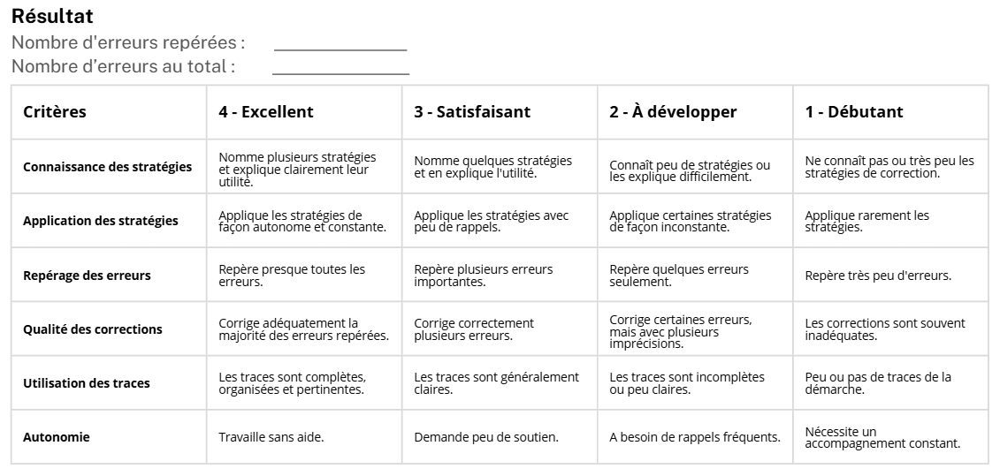
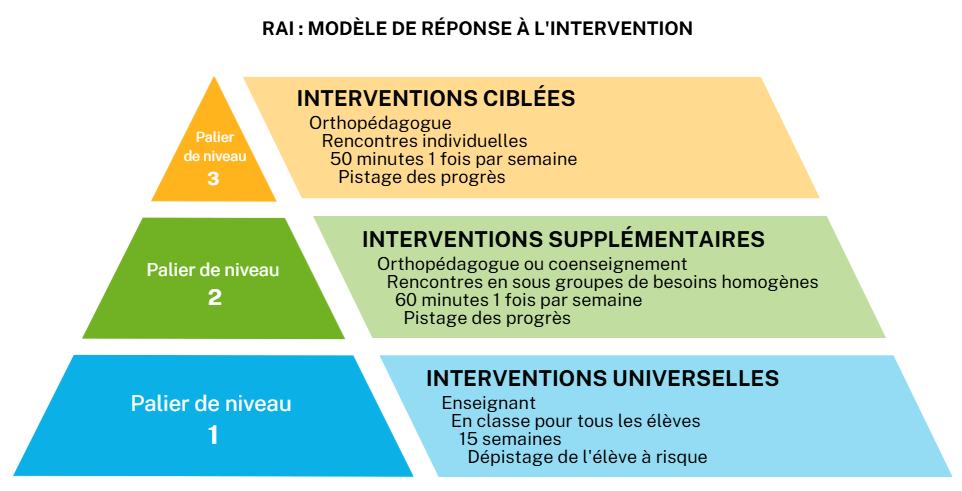

# Courriel de l'orthopédagogue — réponses aux cinq questions du rapport du 31 août

> **Reçu le** : 11 septembre 2026 (collé par Grégoire dans Cowork le soir même)
> **Contexte** : réponses aux cinq questions préparées dans `Rapports/RAPPORT-depistage-etat-et-orthopedagogie-2026-08-31.md` (dépôt Monitorage_v6). Texte reproduit tel quel ; les deux figures sont dans ce dossier (`courriel-2026-09-11_fig1-pyramide-RAI.png`, `courriel-2026-09-11_fig2-grille-qualite-de-la-langue.png`).
> **Ce que Grégoire a dit du contexte, avant de coller le courriel** : elle n'a pas de groupes définis ; elle a seulement des individus avec des horaires différents et des dossiers individuels.

---

## 1. Ce que j'observe

Dans ma pratique, j'observe plusieurs des éléments mentionnés, avec certaines nuances. J'accorde également une attention particulière à des indicateurs qui m'aident à planifier et à ajuster le travail d'intensification.

**La présence.** Le service en orthopédagogie repose sur une démarche volontaire. L'étudiant n'est pas obligé d'y participer, mais lorsqu'il s'engage dans le processus, je m'attends à sa présence et à sa ponctualité aux rendez-vous.

**La remise des travaux.** En orthopédagogie, je ne donne pas de travaux à faire à la maison. Les « productions » correspondent plutôt à des activités d'apprentissage réalisées lors des rencontres.

**La qualité des productions.** Comme mon approche repose sur l'enseignement explicite, j'observe principalement la mise en application des stratégies enseignées. Au-delà du résultat obtenu, je cherche à déterminer si l'étudiant utilise adéquatement la stratégie et si cette utilisation lui permet de répondre aux exigences de la tâche.

**La réponse aux interventions : apprentissage et transfert.**

*Apprentissages.* J'observe dans quelle mesure l'étudiant progresse à la suite des interventions réalisées lors des rencontres.

*Transfert des apprentissages.* J'observe la capacité de l'étudiant à réinvestir les stratégies enseignées dans des tâches authentiques, sans soutien direct de ma part. Le transfert constitue un indicateur important de l'intégration réelle des apprentissages. Il se manifeste lorsque l'étudiant reconnaît lui-même les situations où une stratégie peut être utile, l'applique de façon appropriée et répond plus efficacement aux exigences de la tâche.

## 2. Comment je qualifie une performance

L'approche par niveaux associée à la taxonomie SOLO me paraît pertinente pour qualifier les performances. Toutefois, comme je n'enseigne pas directement un cours, il s'agit d'une approche avec laquelle je suis moins familière.

Par exemple, pour la qualité de la langue, je pourrais utiliser une grille semblable à celle-ci :

Transcription de la grille (en-tête : « Résultat — Nombre d'erreurs repérées : ___ / Nombre d'erreurs au total : ___ ») :

| Critères | 4 – Excellent | 3 – Satisfaisant | 2 – À développer | 1 – Débutant |
|---|---|---|---|---|
| Connaissance des stratégies | Nomme plusieurs stratégies et explique clairement leur utilité. | Nomme quelques stratégies et en explique l'utilité. | Connaît peu de stratégies ou les explique difficilement. | Ne connaît pas ou très peu les stratégies de correction. |
| Application des stratégies | Applique les stratégies de façon autonome et constante. | Applique les stratégies avec peu de rappels. | Applique certaines stratégies de façon inconstante. | Applique rarement les stratégies. |
| Repérage des erreurs | Repère presque toutes les erreurs. | Repère plusieurs erreurs importantes. | Repère quelques erreurs seulement. | Repère très peu d'erreurs. |
| Qualité des corrections | Corrige adéquatement la majorité des erreurs repérées. | Corrige correctement plusieurs erreurs. | Corrige certaines erreurs, mais avec plusieurs imprécisions. | Les corrections sont souvent inadéquates. |
| Utilisation des traces | Les traces sont complètes, organisées et pertinentes. | Les traces sont généralement claires. | Les traces sont incomplètes ou peu claires. | Peu ou pas de traces de la démarche. |
| Autonomie | Travaille sans aide. | Demande peu de soutien. | A besoin de rappels fréquents. | Nécessite un accompagnement constant. |

## 3. Comment je lis une évolution

La fenêtre des trois dernières productions me paraît utile, mais elle ne me permet pas, à elle seule, de lire une évolution réelle.

En orthopédagogie, ce ne sont pas uniquement les résultats des productions qui m'indiquent si l'intervention est efficace. Je suis davantage en mesure de lire une évolution à travers la réponse aux interventions :

- Les interventions orthopédagogiques mises en place produisent-elles les effets attendus ?
- Les apprentissages se traduisent-ils par des changements observables dans les cours ? (résultats qui évoluent, amélioration des dissertations, diminution des erreurs récurrentes, augmentation de l'autonomie, etc.)

Par exemple :

À partir des productions réalisées lors des rencontres orthopédagogiques — l'évaluation de la réponse aux interventions montre que l'apprentissage a lieu : l'élève applique adéquatement les stratégies enseignées et réussit généralement les activités réalisées en contexte d'intervention.

À partir des résultats obtenus dans les situations authentiques (pratiques de dissertation, PFR, EUF) — l'évaluation de la réponse aux interventions montre que le transfert des apprentissages demeure partiel : l'élève éprouve des difficultés à mobiliser les stratégies de façon autonome dans les situations réelles d'évaluation et ne parvient pas à répondre aux exigences.

Le transfert des apprentissages est l'un des principaux défis en orthopédagogie. La réalité est souvent nuancée : il existe un certain transfert, mais celui-ci demeure incomplet, instable ou insuffisant. C'est donc principalement à partir de cette lecture que je suis en mesure de juger de l'évolution de l'étudiant et d'ajuster mes interventions.

## 4. Comment je décide d'intervenir, et à quelle intensité

Transcription de la pyramide (« RAI : modèle de réponse à l'intervention ») :

- **Palier 1 — Interventions universelles** : enseignant ; en classe pour tous les élèves ; 15 semaines ; dépistage de l'élève à risque.
- **Palier 2 — Interventions supplémentaires** : orthopédagogue ou coenseignement ; rencontres en sous-groupes de besoins homogènes ; 60 minutes 1 fois par semaine ; pistage des progrès.
- **Palier 3 — Interventions ciblées** : orthopédagogue ; rencontres individuelles ; 50 minutes 1 fois par semaine ; pistage des progrès.

**Niveau 2** : Selon le modèle RAI inspiré de Vaughn et coll., 2007 (pyramide inversée), je suis déjà en intervention de niveau 2. Je ne sais pas si ça répond à la question 4 et 5 en même temps « ce que je fais ensuite », mais en fonction de l'analyse des résultats obtenus, je vais modifier ma façon d'intervenir et mon approche pédagogique.

**Niveau 3** : Lorsqu'un accompagnement en sous-groupe s'avère insuffisant pour favoriser les progrès attendus, le passage à des rencontres individuelles permet d'offrir un enseignement plus ciblé et adapté aux besoins spécifiques de l'étudiant.

**Services adaptés** : Bien que l'élève ne possède pas de diagnostic officiel, lorsque le dossier orthopédagogique démontre clairement la présence de difficultés persistantes malgré des interventions ciblées et soutenues, une inscription aux Services adaptés peut être envisagée, conformément aux motifs protégés par la Charte.

## 5. Ce que je fais ensuite

*(Répondu avec la question 4 — voir ci-dessus.)*
